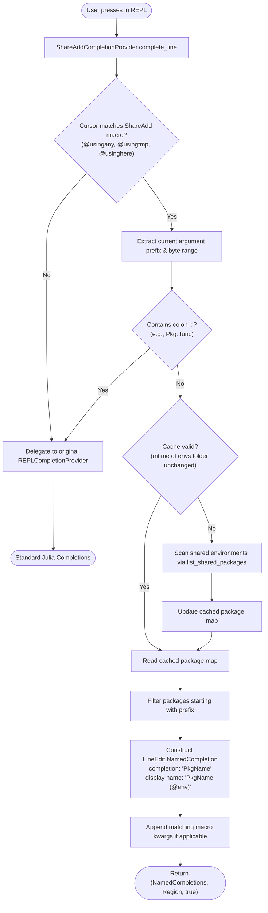

# Implementation Plan: REPL Tab Completion for ShareAdd.jl

**Issue Reference**: [Eben60/ShareAdd.jl#17 (Tab Completion?)](https://github.com/Eben60/ShareAdd.jl/issues/17)  
**Status**: Proposed / Work in Progress  
**Target Julia Versions**: v1.10+

---

## 1. Problem Statement & Background

In the standard Julia REPL, typing `using <TAB>` suggests available packages. However, when using ShareAdd's macros such as `@usingany <TAB>`, no package completions are offered. Instead, the REPL only suggests symbols/modules already defined in the current global scope (`Main`).

### Root Causes in Julia's `REPL.REPLCompletions`
1. **Macro AST Classification**:
   Julia's completion engine parses input using `JuliaSyntax`.
   - `using Foo` is recognized as an `importpath` AST node, which explicitly routes to `complete_loading_candidates!`.
   - `@usingany Foo` is parsed as a `MacroCall`. The REPL assumes macro arguments are arbitrary code expressions and delegates to `complete_symbol!`, matching bindings in `context_module` (`Main`).
2. **`LOAD_PATH` Isolation**:
   Even if package completion were invoked, `complete_loading_candidates!` strictly scans environments currently present in `Base.load_path()`. Because the central design principle of `ShareAdd.jl` is keeping inactive shared environments *out* of `LOAD_PATH` to prevent namespace pollution and dependency conflicts, packages in environments like `@data` or `@plot` are invisible to standard lookups.

---

## 2. Goals & Key Requirements

- **Macro Argument Completion**: Provide tab completion for package names when typing `@usingany`, `@usingtmp`, or `@usinghere`.
- **List & Argument Contexts**: Handle single packages (`@usingany Dat<TAB>`), comma-separated package lists (`@usingany Plots, Dat<TAB>`), and parenthesized syntax (`@usingany(Dat<TAB>)`).
- **Keyword Autocompletion**: Autocomplete accepted keyword arguments (e.g., `update_pkg=true`, `update_env=true`, `update_all=true`).
- **Source Environment Annotations**: In the REPL suggestion list, annotate package names with their originating shared environment(s) (e.g., `DataFrames (@data)`), while inserting only the clean package name (`DataFrames`) into the command line buffer upon selection.
- **Zero Type Piracy & Non-Invasive Design**: Do not overwrite or pirate Base/REPL methods. Wrap the active REPL prompt's completion provider object.
- **Instant Response (< 1ms)**: Cache environment package lists with filesystem `mtime` invalidation so tab completion feels instantaneous.
- **Graceful Fallback**: If the cursor is not in a ShareAdd macro context, delegate immediately and unconditionally to the standard REPL completion provider.

---

## 3. Architecture & Workflow

The solution wraps the prompt's `REPL.LineEdit.CompletionProvider` with a custom `ShareAddCompletionProvider`.



---

## 4. Detailed Component Design

### 4.1 Custom Completion Provider (`src/repl_completion.jl`)

```julia
struct ShareAddCompletionProvider <: REPL.LineEdit.CompletionProvider
    orig::REPL.LineEdit.CompletionProvider
end

# Forward modifier states (Shift+Tab, hints, etc.)
REPL.LineEdit.setmodifiers!(c::ShareAddCompletionProvider, m::REPL.LineEdit.Modifiers) =
    REPL.LineEdit.setmodifiers!(c.orig, m)
```

### 4.2 Context Detection & Range Calculation

The cursor context parser extracts:
1. Which macro is being called (`usingany`, `usingtmp`, `usinghere`).
2. The current argument token under the cursor.
3. The exact character/byte region in the input line to replace.

```julia
function match_shareadd_macro_context(full::String, pos::Int)
    before_cursor = full[1:pos]

    # Match @usingany, @usingtmp, @usinghere (with optional module qualification)
    m = match(r"(?:^|[;|\n])\s*(?:[A-Za-z0-9_]+\.)?@(usingany|usingtmp|usinghere)\b(?:\((.*)| (.*))$"s, before_cursor)
    m === nothing && return nothing

    macro_name = m.captures[1]
    args_str = something(m.captures[2], m.captures[3])

    # Find the boundary of the current argument
    last_delim = something(findlast(c -> c in (',', '(', '['), args_str), 0)
    curr_arg = args_str[last_delim+1:end]

    # If the user typed a colon (e.g. @usingany Pkg: fn), leave to standard completions
    occursin(':', curr_arg) && return nothing

    stripped_prefix = lstrip(curr_arg)
    prefix_start_in_args = last_delim + (length(curr_arg) - length(stripped_prefix)) + 1

    args_start_in_full = pos - length(args_str) + 1
    token_start = args_start_in_full + prefix_start_in_args - 1
    token_range = token_start:pos

    return (; macro_name, prefix = stripped_prefix, token_range)
end
```

### 4.3 Candidate Generation with Source Annotations

Julia's `REPL.LineEdit.NamedCompletion(completion, name)` allows decoupling the inserted string from the displayed string:
- `c.completion = "DataFrames"` (inserted into prompt buffer and used for common prefix expansion).
- `c.name = "DataFrames (@data)"` (rendered in the interactive completion menu).

```julia
function get_shareadd_completions(macro_name::AbstractString, prefix::AbstractString)
    shared_pkgs = get_cached_shared_packages()
    
    completions = REPL.LineEdit.NamedCompletion[]
    for (pkg_name, pkg_info) in shared_pkgs
        if startswith(pkg_name, prefix)
            env_label = isempty(pkg_info.envs) ? "" : " (@" * join((e.name for e in pkg_info.envs), ", @") * ")"
            push!(completions, REPL.LineEdit.NamedCompletion(pkg_name, pkg_name * env_label))
        end
    end

    if macro_name == "usingany"
        for kw in ("update_pkg=true", "update_env=true", "update_all=true")
            startswith(kw, prefix) && push!(completions, REPL.LineEdit.NamedCompletion(kw, kw))
        end
    elseif macro_name == "usinghere"
        for kw in ("all=true", "only=true")
            startswith(kw, prefix) && push!(completions, REPL.LineEdit.NamedCompletion(kw, kw))
        end
    end

    sort!(completions, by = c -> c.completion)
    return completions
end
```

### 4.4 High-Performance Caching Strategy

Querying disk manifests on every tab press costs ~25–30ms. With filesystem timestamp checking, lookup latency drops to <0.05ms:

```julia
mutable struct CompletionCache
    last_mtime::Float64
    packages::Dict{String, PackageInfo}
end

const COMPLETION_CACHE = CompletionCache(0.0, Dict{String, PackageInfo}())

function get_cached_shared_packages()
    envs_dir = env_folders().envs_folder
    current_mtime = isdir(envs_dir) ? mtime(envs_dir) : 0.0

    if current_mtime != COMPLETION_CACHE.last_mtime || isempty(COMPLETION_CACHE.packages)
        COMPLETION_CACHE.packages = list_shared_packages(; std_lib = true)
        COMPLETION_CACHE.last_mtime = current_mtime
    end
    return COMPLETION_CACHE.packages
end

function invalidate_completion_cache!()
    COMPLETION_CACHE.last_mtime = 0.0
    empty!(COMPLETION_CACHE.packages)
    return nothing
end
```
Cache invalidation is also hooked into operations that mutate environments (`install_shared`, `delete_shared_env`, etc.).

### 4.5 REPL Hooking & Activation Lifecycle

Activation hooks into `ShareAdd.__init__()`:

```julia
function setup_repl_completion!(repl = Base.active_repl)
    if isdefined(repl, :interface) && isdefined(repl.interface, :modes) && !isempty(repl.interface.modes)
        main_mode = repl.interface.modes[1]
        if !(main_mode.complete isa ShareAddCompletionProvider)
            main_mode.complete = ShareAddCompletionProvider(main_mode.complete)
        end
    end
    return nothing
end
```

In `src/ShareAdd.jl`:
```julia
function __init__()
    if isinteractive()
        if isdefined(Base, :active_repl)
            setup_repl_completion!(Base.active_repl)
        end
        atreplinit() do repl
            setup_repl_completion!(repl)
        end
    end
end
```

---

## 5. Scope & Limitations

| Context | Supported? | Explanation |
| :--- | :---: | :--- |
| **Julia REPL (Terminal)** | Yes | Fully supported via `ShareAddCompletionProvider`. |
| **VS Code Integrated Terminal** | Yes | Runs the standard Julia REPL, so completion works automatically. |
| **VS Code Editor (`.jl` files)** | No | Static auto-complete inside editor buffers is controlled by `LanguageServer.jl` (LSP) which operates in an independent process and only indexes the active project manifest. |
| **Package Submodules (`@usingany Pkg: ...`)** | Delegated | If a package is not yet loaded, its internal symbols are unknown; once loaded, standard symbol completion handles it. |

---

## 6. Implementation Steps & Task Breakdown

### Phase 1: Core Completion Module
- [ ] Create `src/repl_completion.jl`.
- [ ] Implement `ShareAddCompletionProvider`, `match_shareadd_macro_context`, and `get_shareadd_completions`.
- [ ] Implement `COMPLETION_CACHE` with `mtime` validation and `invalidate_completion_cache!`.
- [ ] Hook `invalidate_completion_cache!()` into environment mutating functions (`install_shared`, `delete`, `reset`).

### Phase 2: Integration & Lifecycle
- [ ] Include `src/repl_completion.jl` in `src/ShareAdd.jl`.
- [ ] Add `setup_repl_completion!` to `__init__()` with `isinteractive()` and `atreplinit()`.
- [ ] Expose an optional toggle: `ShareAdd.enable_tab_completion!(enable::Bool = true)`.

### Phase 3: Testing & Verification
- [ ] Create `test/tests_repl_completion.jl` wrapped in `@testset "REPL Tab Completion"`.
- [ ] Unit test context parsing:
  - `@usingany `
  - `@usingany Dat`
  - `@usingany Plots, Dat`
  - `@usingany(Dat`
  - `@usingany update_`
  - Preceding statements: `x = 1; @usingany Dat`
  - Non-ShareAdd macros: `@show Dat` (must return `nothing`)
  - Sub-imports: `@usingany Pkg: foo` (must return `nothing`)
- [ ] Unit test caching and invalidation behavior.
- [ ] Integration test with simulated `LineEdit.PromptState`.

### Phase 4: Documentation
- [ ] Update `AGENTS.md` with notes on `src/repl_completion.jl` and REPL completion mechanics.
- [ ] Update `README.md` highlighting the tab-completion capability for `@usingany`.
- [ ] Respond to and link the plan on GitHub Issue #17.

